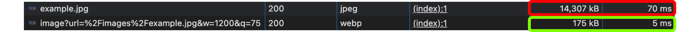
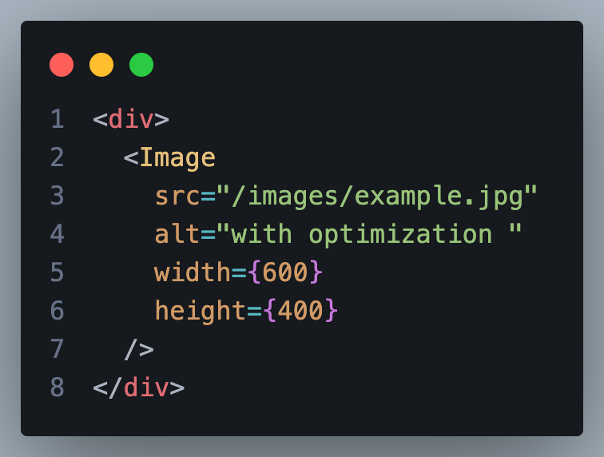
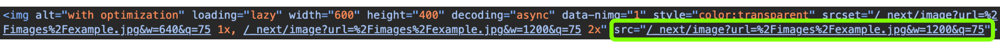
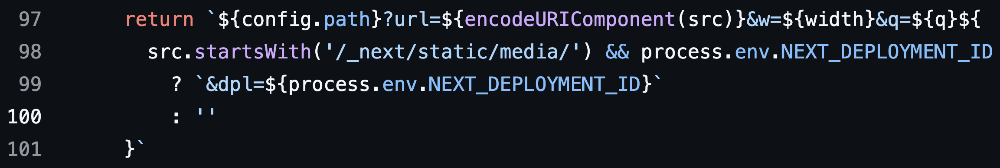
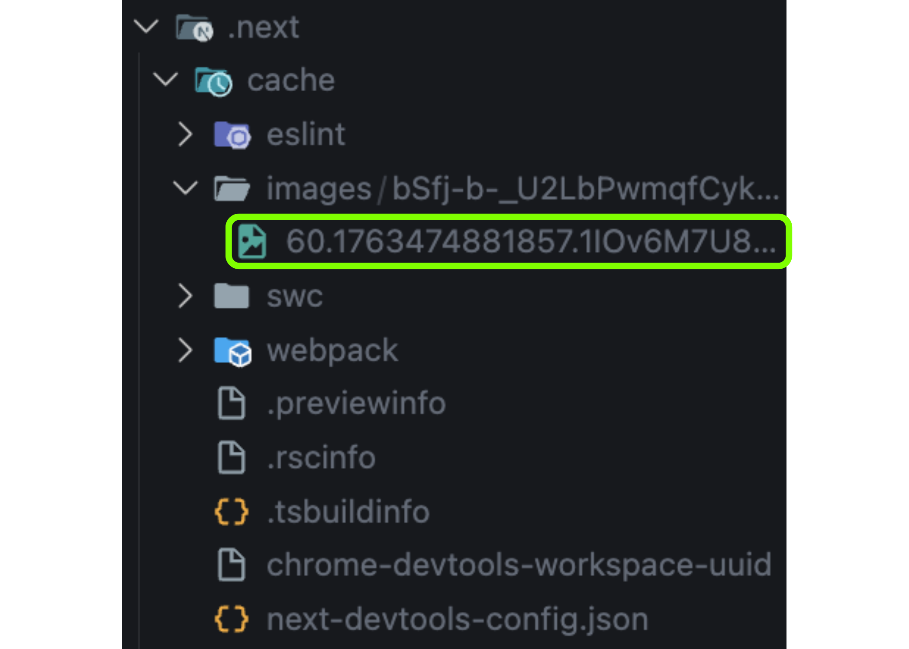
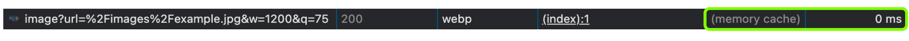
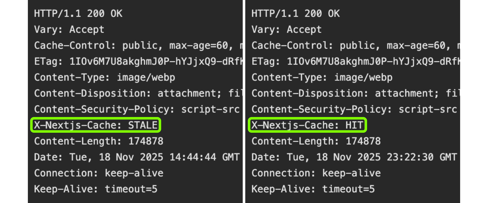

## 목적

오늘 개발을 하다가, 평소 아무 생각 없이 사용하던 Next.js의 `next/image` 컴포넌트를 왜 쓰는지, 그리고 이 컴포넌트가 이미지를 어떤 방식으로 최적화하는지 문득 궁금해졌다. 그래서 이에 대해 정리해보고자 블로그를 작성하게 되었다.

## `next/image`에서 제공하는 기능

Next.js가 기본으로 제공하는 주요 기능은 다음과 같다.

- 디바이스 크기에 맞는 적절한 이미지 해상도와 최신 이미지 포맷을 자동으로 지원.
- Web Vitals의 CLS(누적 레이아웃 변경) 발생을 줄여 사용자 경험을 개선.
- lazy loading이 기본 적용되어 뷰포트에 노출될 때 이미지를 로드하고, 선택적으로 블러 처리된 플레이스홀더를 먼저 보여주는 기능 제공.
- 이미지 리사이징을 지원하며, 외부 이미지에 대해서도 리사이징이 가능.

[Next.js 이미지 최적화 문서](https://nextjs.org/docs/app/getting-started/images)

## `img` VS `next/image`

HTML의 기본 이미지 태그인 `img`와 `next/image` 컴포넌트의 동작을 비교해보자.

위 스크린샷은 Chromium 기반 브라우저에서 14.3MB 크기의 이미지를 로드했을 때의 결과이다.

- 빨간 사각형: 일반 `img` 태그로 로드한 경우, 이미지 다운로드 크기 **14,307KB**, 로드 시간 **70ms**
- 녹색 사각형: `next/image` 컴포넌트로 로드한 경우, 이미지 다운로드 크기 **175KB**, 로드 시간 **5ms**

결과만 봐도 큰 차이가 드러난다. 단순히 몇 ms의 차이라고 생각할 수도 있지만, 사용자의 네트워크 환경이 좋지 못한 상황에서는 이 차이가 훨씬 크게 체감될 수 있다.

네트워크 환경 차이를 직접 느껴보고 싶다면 브라우저에서 네트워크 쓰로틀링을 적용해 테스트할 수 있다. 실제로 Fast 4G 환경에서 테스트해보니,

- `img` 태그는 **약 15초**,
- `next/image`는 **약 0.6초**

정도로 차이가 났다.

그렇다면 이제 Next.js가 어떻게 이런 성능 차이를 만들어내는지 살펴보자.

## `next/image` 사용 예시와 렌더링 결과

먼저 에디터에서 작성한 모습이다. 아래 사진은 `next/image` 컴포넌트를 사용하는 예시로, 일반 `img` 태그와 비슷하게 `src`, `width`, `height`를 사용하는 형태다.

다음은 브라우저에서 렌더링된 결과이다. 동일한 이미지를 사용했지만, 이미지 경로가 코드에서 지정한 경로와 다르게 `/_next/image`로 변경된다. 그리고 뒤에는 쿼리스트링 형태로 우리가 지정한 이미지 경로(`url`), Next.js가 선택한 최적화된 너비(`w=1200`), 품질 설정 값(`q=75`)이 함께 전달되고있다.

이처럼 원본 이미지 경로가 아닌 `/_next/image` 요청으로 바뀌는 이유는 `next/image` 컴포넌트의 **loader** 기능 때문이다.

[Next.js image-component.tsx 소스 코드](https://github.com/vercel/next.js/blob/canary/packages/next/src/client/image-component.tsx)

위 코드는 `next/image` 내부 동작의 일부다. Next.js 서버는 실행 시 `/_next/image` 라우트를 자동으로 생성하며, 이 라우트에서 이미지 최적화 로직이 수행된다. 기본 loader를 사용하고 있다면 모든 이미지 요청은 이 경로로 변환되고, Next.js는 여기서 필요한 리사이징, 포맷 변환, 압축 등을 처리한다.

- **w**: 이미지의 최종 너비. `next.config.js`의 `deviceSizes`·`imageSizes` 목록을 기준으로, 현재 화면 크기와 DPR(Device Pixel Ratio)에 따라 Next.js가 가장 적합한 값을 자동 선택한다.
- **q**: 이미지 품질. `quality` prop으로 지정할 수 있으며, 값을 제공하지 않으면 기본값 **75**가 전달된다.

### DPR(Device Pixel Ratio)

**DPR = 물리적 픽셀 / CSS 픽셀**

DPR이 높을수록 화면이 더 많은 물리적 픽셀로 구성되므로, 더 선명한 이미지가 필요하다. Next.js는 이를 감안해 적절한 이미지 사이즈를 자동으로 선택한다.

예를 들어, CSS에서 100×100 픽셀로 설정한 이미지를 브라우저에 표시한다고 가정해보자.

* **DPR 1**: 실제 화면에서도 100×100 물리적 픽셀로 렌더링되므로 문제가 없다.
* **DPR 2**: 같은 100×100 CSS 픽셀 영역이 실제로는 200×200 물리적 픽셀로 렌더링된다.
  -> 원본 이미지가 100×100 픽셀이라면, 브라우저가 이미지를 200×200으로 확대하면서 픽셀이 늘어나 흐릿하게 보인다.

즉, DPR이 높은 화면에서는 원본 이미지 해상도가 충분하지 않으면 이미지가 선명하게 표시되지 않는다. Next.js는 이 점을 고려해, 화면 크기와 DPR에 맞는 최적의 이미지 크기를 자동으로 선택해 렌더링한다.

### `w` 값 계산 방식

**w는 현재 화면 크기 + 디스플레이 배율(DPR)을 기준으로 Next.js가 자동 계산한 이미지 너비이다.** 계산 시 `next.config.js`에 설정된 `deviceSizes`와 `imageSizes` 값이 사용되며, 이 목록 중 가장 적합한 해상도를 선택해 최적화된 이미지를 제공한다.

예를 들어, 다음과 같은 환경이라면:

- 화면에서 이미지가 차지하는 CSS width: 300px
- 디스플레이 배율(DPR): 2
  -> 실제 필요한 물리 픽셀: **600px**

Next.js는 600px에 가장 가까운 `deviceSizes` 값을 찾아 `w=` 파라미터로 전달한다. 이렇게 함으로써 고해상도 디스플레이에서도 선명한 이미지를 제공하면서도, 불필요하게 큰 이미지를 내려받지 않도록 최적화한다.

## 이미지 최적화 시점과 이미지 재사용

Next.js는 이미지 요청이 들어오면 `.next` 디렉터리 내부의 `cache/images` 폴더에 최적화된 이미지를 동적으로 생성한다. 이후 동일한 요청이 다시 들어오면, 이미 생성해둔 최적화 이미지 파일을 그대로 재사용해 불필요한 연산을 줄인다.

아래 사진은 사용자가 실제로 이미지를 요청한 뒤 생성된 캐시 파일을 보여주는 모습이다. 최적화된 이미지가 `.next/cache/images` 내부에 저장된 것을 확인할 수 있다.

Next.js 서버가 처음 기동되고 **첫 번째 이미지 요청이 들어오는 경우**, 최적화 로직이 동작하기 때문에 상대적으로 시간이 조금 더 걸린다. 하지만 **한 번 최적화가 끝난 후 동일한 이미지가 다시 요청되면**, 저장된 캐시 파일을 곧바로 반환하기 때문에 훨씬 빠르게 응답한다.

아래 사진에서 확인할 수 있듯이, 이미 최적화되어 캐시가 존재하는 경우 응답 시간이 **0ms**로 거의 즉시 반환된다.

그리고 최적화된 캐시 이미지를 사용했는지 여부는 Next.js가 추가로 전달하는 응답 헤더를 통해 확인할 수 있다.

* **STALE**: 캐시가 존재하지 않아 새로 최적화 작업을 수행한 경우
* **HIT**: 이미 캐시된 최적화 이미지가 존재해 이를 재사용한 경우

응답 헤더의 `X-Nextjs-Cache` 값을 확인하면, 해당 요청이 최적화된 이미지를 새로 생성한 것인지, 아니면 캐시된 이미지를 재사용한 것인지 쉽게 판단할 수 있다.

## WebP, AVIF 등 최신 포맷으로 자동 변환

Next.js는 클라이언트가 어떤 이미지 포맷을 지원하는지 판단해서,
가능하다면 JPEG 같은 기존 포맷을 WebP나 AVIF처럼 **더 가볍고 효율적인 최신 포맷으로 자동 변환해서 전달**한다.

브라우저가 해당 포맷을 지원하지 않으면 원본 포맷을 그대로 유지해 전달하므로 호환성 걱정도 없다.

덕분에 네트워크 비용이 줄어들고, 체감 이미지 로딩 속도도 훨씬 빨라진다. 실제로 모바일 환경처럼 네트워크 품질이 낮을수록 이 차이가 더 크게 느껴진다.

## Lazy Loading + Viewport 기반 지연 로딩

Next.js의 이미지 컴포넌트는 **기본적으로 Lazy Loading**이 적용된다.
즉, 화면에 보이지 않는 이미지는 아예 로드하지 않고, `IntersectionObserver`를 기반으로 **뷰포트 근처에 왔을 때 로드**된다.

이 방식은 특히 다음과 같은 상황에서 효과가 크다:

* LCP(Largest Contentful Paint) 개선
* 스크롤이 긴 페이지, 피드 형태 UI, 이미지가 많은 목록 구조
* 모바일 환경에서의 초기 로딩 속도 향상

불필요하게 이미지를 먼저 받아오지 않기 때문에 초기 렌더링 부담이 크게 줄고, 스크롤할 때마다 필요한 시점에만 자연스럽게 로드된다.

## 마무리

오늘은 Next.js가 이미지를 어떤 방식으로 최적화하는지, 그리고 그 결과가 실제 렌더링 과정에서 어떻게 나타나는지 직접 확인해보았다. 평소에는 "좋다니까 쓰자" 느낌으로 아무 생각 없이 `next/image`를 사용했는데, 내부 동작을 이렇게 살펴보니 최적화 과정이 꽤 체계적이고 똑똑하게 이루어진다는 걸 알 수 있어 흥미로웠다.

그리고 글의 주제와는 조금 별계로, 오랜만에 한 가지를 깊게 파고들어 분석해보니 힘들면서도 은근히 재미있었다. 이런 탐구 과정을 통해 더 많이 배우고, 개발을 바라보는 시야도 확실히 넓어지는 것 같다.
